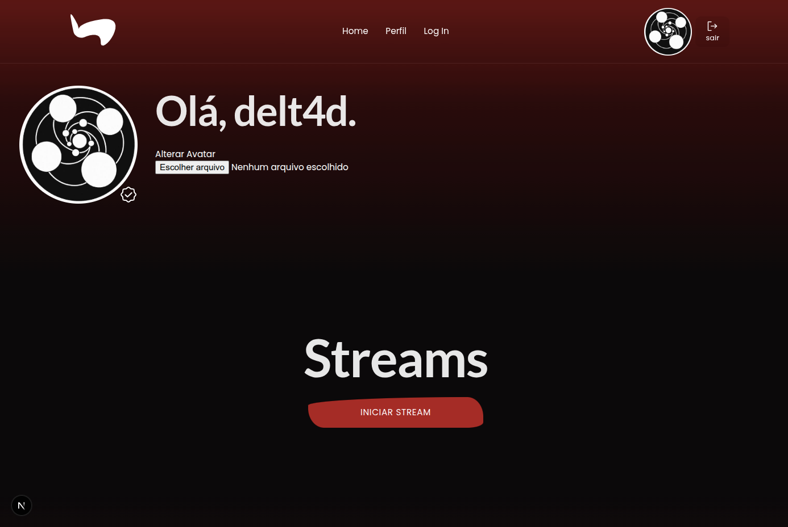
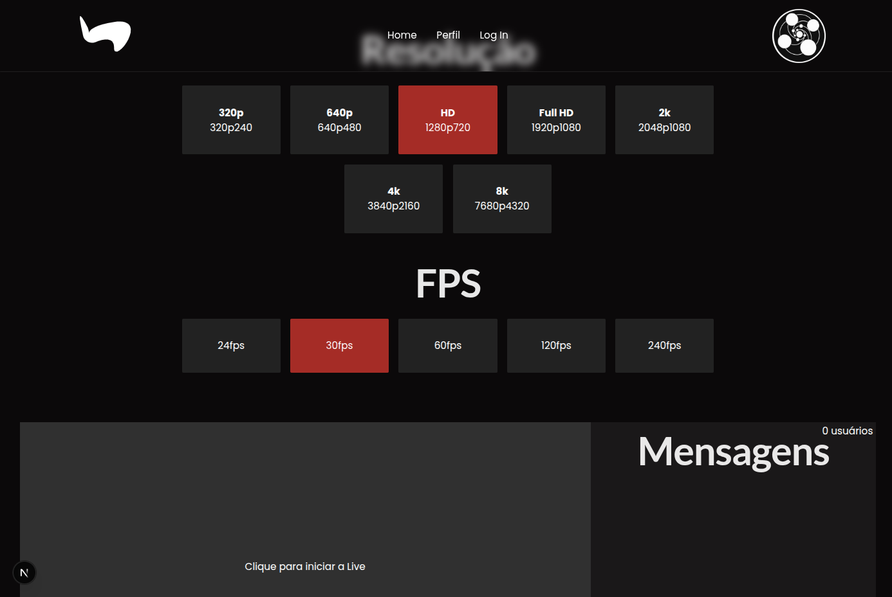
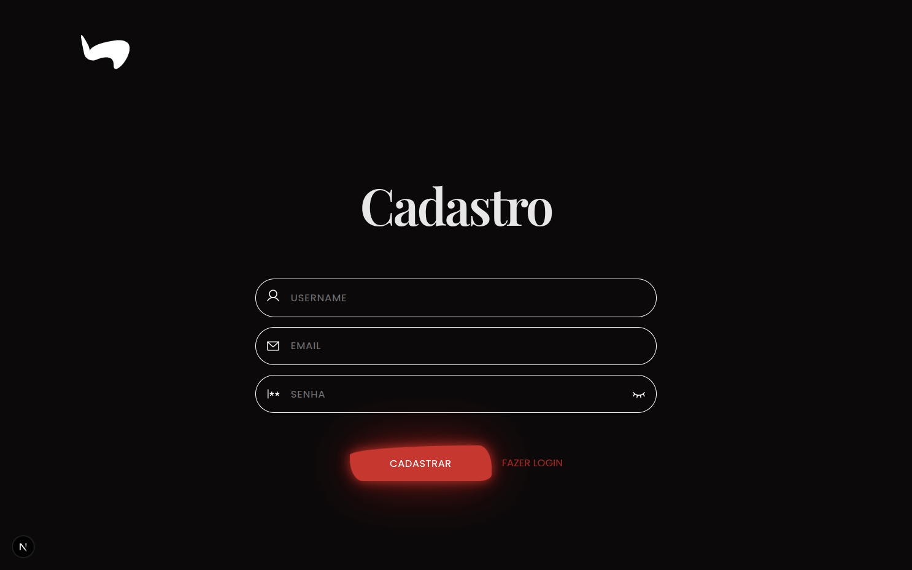

# Wany Website

Site que permite o upload, download e streaming sobre o desenvolvimento de jogos independentes.

## Pré-visualização

Algumas telas do site:

<p align="center">
  
</p>
<p align="center">
  
</p>
<p align="center">
  
</p>

## Preparação

- Execute o comando `npm install` nas pastas `Client` e `Server`.
- Na pasta `Server`, duplique o arquivo `.env.example` e renomeie para `.env`.
- Edite o arquivo `.env` com os valores adequados:
    - `HOST`: o host onde a aplicação vai rodar (ex: localhost)
    - `PORT`: a porta onde a aplicação rodará
    - `SECRET_TOKEN`: digite alguma string grande e aleatória
    - `DB_*`: preencha cada campo com prefixo `DB_` com a credencial equivalente do seu banco de dados MySQL

## Subindo o banco de dados com Docker

- Certifique-se de ter o [Docker](https://www.docker.com/) e o [Docker Compose](https://docs.docker.com/compose/) instalados.
- Na raiz do projeto, execute:
    ```sh
    docker-compose up -d
    ```
- Isso irá subir um container MySQL configurado conforme o arquivo `docker-compose.yml`.

## Como rodar

- Para iniciar o servidor, vá na pasta `Server` e execute pelo terminal:
    - `npm run dev` para executar o ambiente de desenvolvimento
    - `npm run build` para criar o ambiente de distribuição
    - `npm run start` para executar o ambiente de distribuição
- Para iniciar o cliente, vá para a pasta `Client` e execute pelo terminal:
    - `npm run dev` para executar o ambiente de desenvolvimento
    - `npm run build` para criar o ambiente de distribuição
    - `npm run start` para executar o ambiente de distribuição
